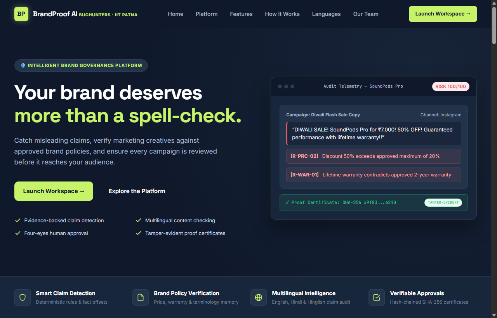
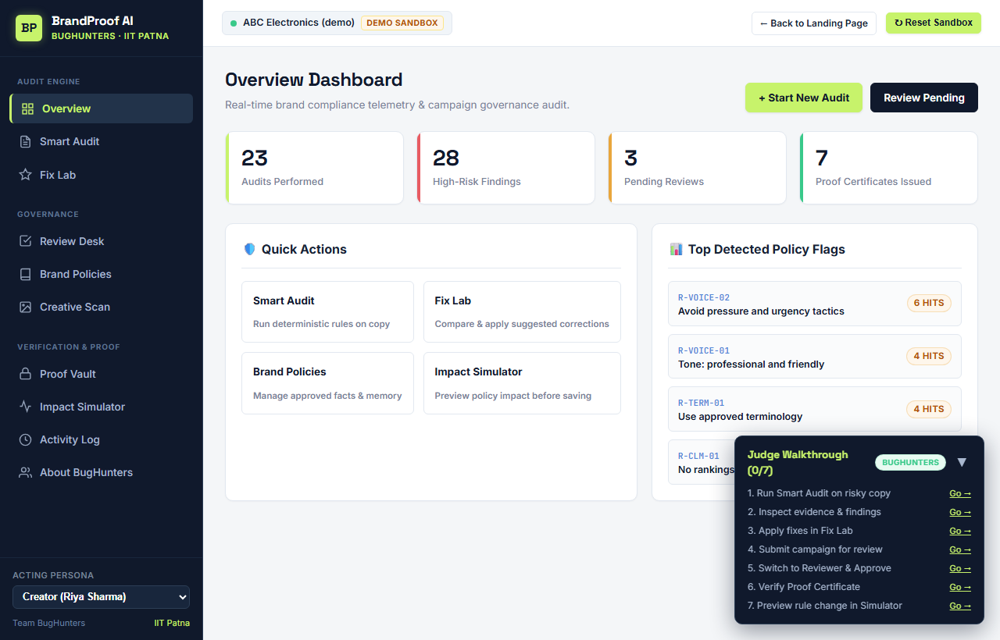
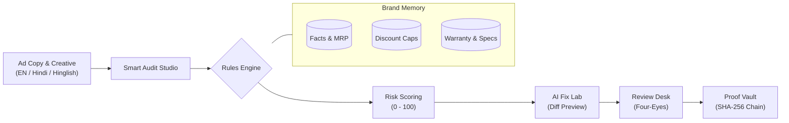
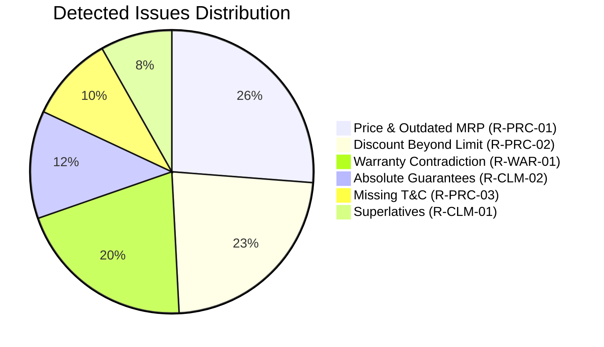
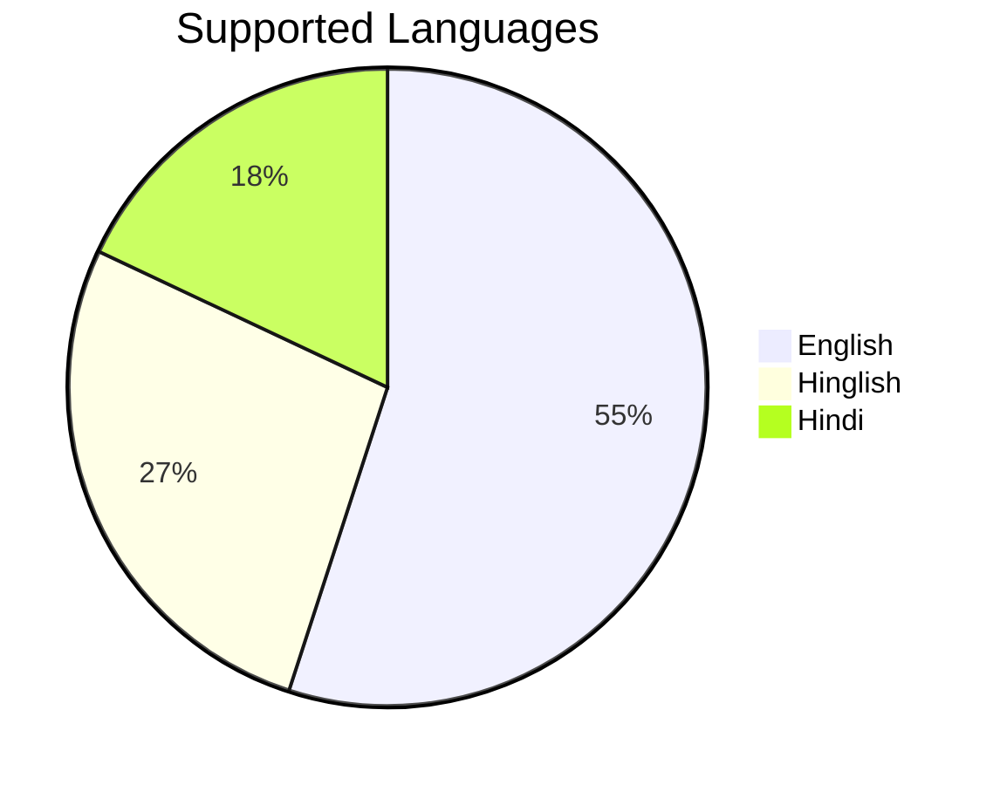
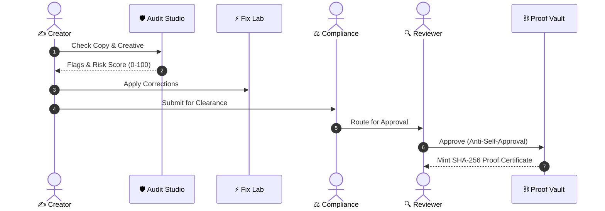
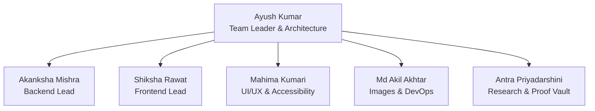

# BrandProof AI — BugHunters Edition

<p align="center">
  
  <br>
  <b>Every claim checked. Every flag proven.</b>
  <br>
  <i>Intelligent brand-governance platform by Team BugHunters, IIT Patna.</i>
</p>

<p align="center">
  
  
  
  
  
</p>

---

## 📸 Product Preview

<p align="center">
  <b>Public Landing Page</b>
  <br>
  
</p>

<p align="center">
  <b>Governance Workspace Dashboard</b>
  <br>
  
</p>

---

## ⚡ Architecture Pipeline



---

## 📊 Telemetry & Coverage





---

## 🔄 Governance Lifecycle



---

## 🚀 Quickstart

```bash
# 1. Clone & install
git clone https://github.com/mahik2007/BrandProof-AI.git
cd BrandProof-AI
python -m venv .venv && source .venv/bin/activate  # Windows: .venv\Scripts\activate
pip install -r requirements.txt

# 2. Run local server
python -m uvicorn app.main:app --host 127.0.0.1 --port 8000 --reload

# 3. Test suite
python -m pytest -q
```

- **Landing Page:** `http://127.0.0.1:8000/`
- **Workspace:** `http://127.0.0.1:8000/workspace`
- **API Docs:** `http://127.0.0.1:8000/docs`

---

## 👥 Team BugHunters (IIT Patna)



<p align="center">
  <b>BrandProof AI — BugHunters Edition</b> • IIT Patna
</p>
