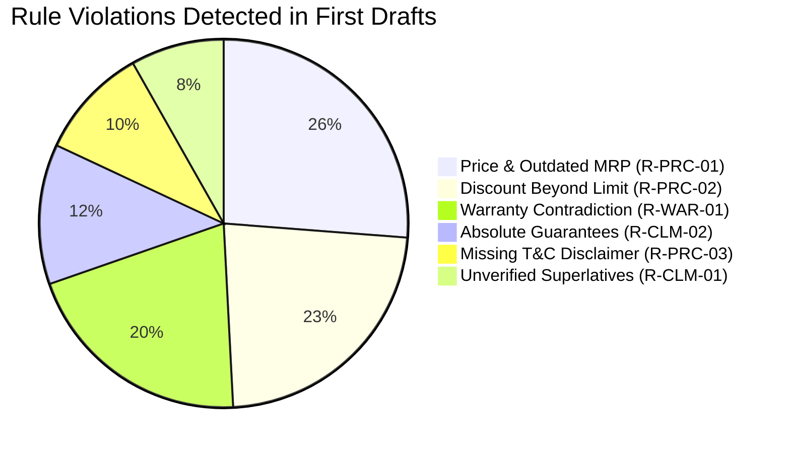
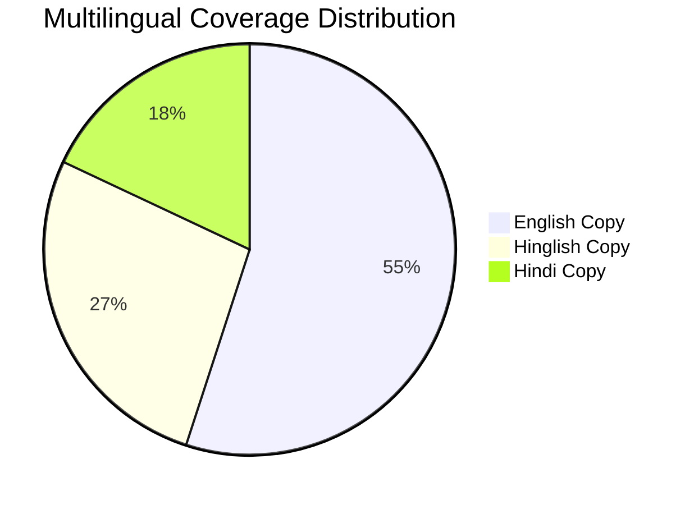
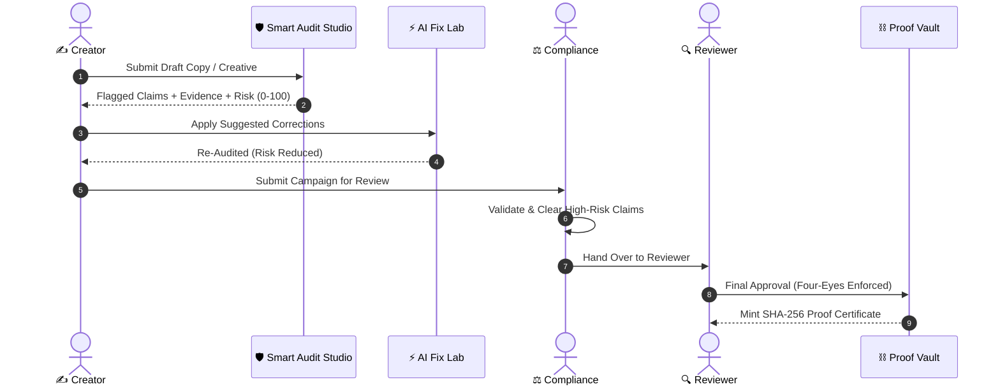
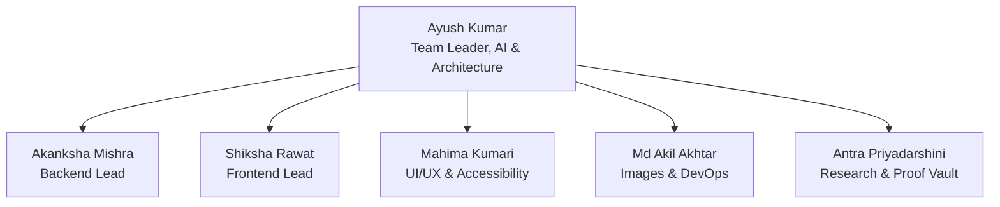

# BrandProof AI — BugHunters Edition

<p align="center">
  
  <br>
  <b>Every claim checked. Every flag proven.</b>
  <br>
  <i>An intelligent brand-governance platform developed by Team BugHunters, IIT Patna.</i>
</p>

<p align="center">
  
  
  
  
  
</p>

---

## ⚡ System Architecture

```mermaid
flowchart LR
    A["Marketing Copy & Creatives\n(EN / Hindi / Hinglish)"] --> B["Smart Audit Studio"]
    B --> C{"Deterministic Rules Engine"}
    
    subgraph Brand Memory
      M1[("Product Facts & MRP")]
      M2[("Discount Thresholds")]
      M3[("Warranty & Specs")]
      M4[("Approved Terminology")]
    end
    
    C <--> Brand Memory
    C --> D["Risk Scoring\n(0 - 100)"]
    D --> E["AI Fix Lab\n(Diff & Purpose Guard)"]
    E --> F["Review Desk\n(Four-Eyes Approval)"]
    F --> G["Proof Vault\n(SHA-256 Hash Chain)"]
```

---

## 📊 Evaluation & Detection Breakdown





---

## 🔄 Four-Eyes Governance Lifecycle



---

## 🛠️ Feature Matrix

| Module | Core Functionality | Telemetry / Output |
|---|---|---|
| **🛡️ Smart Audit Studio** | Tokenizes text in English, Hindi & Hinglish | Text offsets, severity tags, risk $0-100$ |
| **⚡ AI Fix Lab** | Deterministic claim rewrite & diff comparison | Live risk drop & Purpose Guard check |
| **📖 Brand Policy Centre** | Versioned facts, prices, warranty & banned terms | Single-source-of-truth brand memory |
| **🖼️ Creative Scan** | Image template match, contrast & palette $\Delta E$ | Logo detection & color compliance score |
| **👥 Review Desk** | Role-based approval (Creator $\to$ Compliance $\to$ Reviewer) | Four-eyes enforcement (anti-self-approval) |
| **⛓️ Proof Vault** | SHA-256 hash chaining of approved campaigns | Cryptographic tamper-evident certificate |
| **🔮 Impact Simulator** | Previews policy change impact on past campaigns | Affected campaigns count before commit |
| **📜 Activity Log** | Chronological record of all team decisions | Transparent governance history |

---

## 🚦 Quickstart

```bash
# 1. Clone & install dependencies
git clone https://github.com/mahik2007/BrandProof-AI.git
cd BrandProof-AI
python -m venv .venv
source .venv/bin/activate  # Windows: .venv\Scripts\activate
pip install -r requirements.txt

# 2. Run local server
python -m uvicorn app.main:app --host 127.0.0.1 --port 8000 --reload

# 3. Run automated tests (47 tests)
python -m pytest -q
```

- **Landing Page:** `http://127.0.0.1:8000/`
- **Application Workspace:** `http://127.0.0.1:8000/workspace`
- **API Documentation:** `http://127.0.0.1:8000/docs`

---

## 👥 Team BugHunters (IIT Patna)



<p align="center">
  <b>BrandProof AI — BugHunters Edition</b> • IIT Patna
  <br>
  <i>“Trust every claim before it goes live.”</i>
</p>
